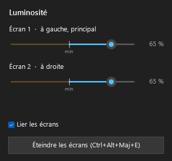
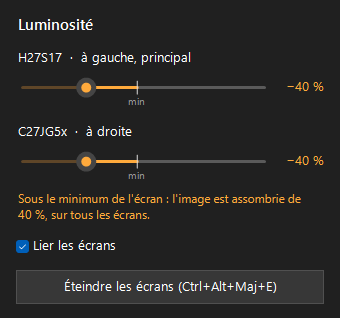
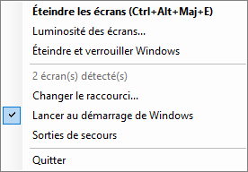
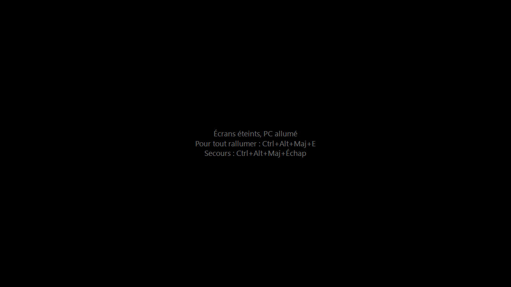
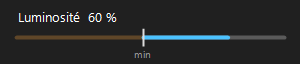
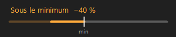

<p align="center">
  
</p>

<h1 align="center">Eclipse</h1>

<p align="center">
  <b>Éteignez vos écrans sans mettre le PC en veille, et réglez leur luminosité, jusque sous leur minimum.</b><br>
  <i>Turn your monitors off without putting the PC to sleep, and dim them, even below their minimum.</i>
</p>

<p align="center">
  <a href="../../releases/latest"><b>Télécharger / Download</b></a> ·
  <a href="#français">Français</a> ·
  <a href="#english">English</a>
</p>

<p align="center">
  
  &nbsp;&nbsp;
  
</p>

---

## Français

Eclipse est un petit programme pour Windows qui vit près de l'heure, dans la barre des tâches. Il fait deux choses.

**1. Éteindre les écrans, le PC restant allumé.** D'un raccourci, les écrans s'éteignent, le clavier et la souris sont
bloqués et le son est coupé. Pendant ce temps, le PC continue de travailler : un téléchargement, un rendu, un calcul,
de la musique sur une autre sortie… Le même raccourci rallume tout.

**2. Régler la luminosité des écrans,** directement depuis Windows, sans passer par les boutons de l'écran. Et quand
le minimum de l'écran est encore trop lumineux, la nuit, Eclipse descend **en dessous**.

Un seul fichier, environ 130 Ko, sans installation. Il ne s'appuie que sur ce qui est déjà dans Windows.

### Aperçu

| | |
|---|---|
|  | **Le menu de l'icône** (clic droit). Un double-clic sur l'icône éteint, un simple clic ouvre la luminosité. |
|  | **5 secondes avant l'extinction**, le temps d'annuler (Échap ou le même raccourci). |
|  | **Pendant l'extinction.** Si vous touchez la souris ou une touche, l'écran se réveille 5 secondes pour vous rappeler comment rallumer, puis se rééteint. |
| <br> | **Le rappel** en bas de l'écran, quand vous réglez la luminosité au clavier. Il ne prend pas le clavier. |

### Raccourcis

| Raccourci | Effet |
|---|---|
| **Ctrl + Alt + Maj + E** | Éteint les écrans, puis les rallume. Il se change depuis le menu. |
| **Ctrl + Alt + Maj + Échap** | Sortie de secours : tout revient, tout de suite. |
| **Ctrl + Alt + Maj + ↑ / ↓** | Luminosité +10 % / −10 % sur tous les écrans. Arrivé au minimum, ↓ continue en dessous. |
| **Clic** sur l'icône | Le panneau de luminosité |
| **Double-clic** sur l'icône | Éteint les écrans |

Dans le panneau, on peut aussi utiliser la molette (±5 %), les flèches (±1 %) et Page haut / bas (±10 %).

### Ce qu'il fait, en détail

**L'extinction**
- **Les écrans s'éteignent vraiment** : ce n'est pas un simple fond noir. Le PC, lui, ne se met pas en veille.
- **Le clavier et la souris sont bloqués**, pour qu'un chat ou un enfant ne fasse rien à votre place. Seuls le raccourci et la sortie de secours rallument.
- **Le son est coupé**, par un simple « muet » des sorties de Windows. Aucun volume n'est changé, et le muet est retiré au retour, même après un arrêt brutal.
- **SteelSeries Sonar** : si vous l'utilisez, ses sorties sont notées avant l'extinction et remises au rallumage. Sans cela, Sonar bascule parfois sur le mauvais écran quand ils se rallument.
- **« Éteindre et verrouiller Windows »** fait la même chose, puis verrouille la session.
- **Au bout de 12 heures**, le clavier, la souris et le son reviennent seuls.

**La luminosité**
- **Un curseur par écran**, avec le nom de l'écran tel qu'il se présente à Windows et sa position (à gauche, à droite…).
- **« Lier les écrans »** pour les régler ensemble.
- **Sous le minimum** : à gauche du trait « min », le curseur passe en orange et descend jusqu'à −90 %. L'écran reste à son minimum réel, et c'est l'image qui est assombrie par l'effet de couleur de Windows. Pas de fenêtre posée par-dessus : rien ne cache, rien ne bloque les clics. L'effet disparaît de lui-même si Eclipse s'arrête.

### Installer

1. Téléchargez **Eclipse.exe** depuis la [dernière version](../../releases/latest).
2. Lancez-le. Son icône apparaît près de l'heure (au besoin, derrière la flèche **^**).
3. Clic droit sur l'icône, puis **« Lancer au démarrage de Windows »** si vous le voulez à chaque démarrage.

> **« Windows a protégé votre ordinateur »** : Eclipse n'est pas signé (un certificat coûte cher). Cliquez sur
> *Informations complémentaires*, puis *Exécuter quand même*. Vous pouvez aussi le compiler vous-même, voir ci-dessous.

**Pour régler la luminosité**, l'option **DDC/CI** doit être activée dans le menu de vos écrans. Elle l'est le plus
souvent par défaut. Un écran qui ne répond pas est signalé dans le panneau.

**Désinstaller** : clic droit sur l'icône, *Quitter*, puis supprimez le fichier. Eclipse ne laisse que son journal,
dans `%LOCALAPPDATA%\Eclipse`, et ses réglages, dans `HKCU\Software\Eclipse`.

### Compiler soi-même

Pas de Visual Studio, pas de .NET à installer : le compilateur du .NET Framework 4 est déjà dans Windows.

```bat
git clone https://github.com/Hosni-Ismail/Eclipse.git
cd Eclipse
Compiler.bat
```

Tout le programme tient dans [`Eclipse.cs`](Eclipse.cs). Les commentaires expliquent chaque choix.

### Vie privée et sécurité

- **Rien n'est envoyé sur Internet.** Le seul échange réseau est local, avec SteelSeries Sonar, s'il est installé.
- **Eclipse n'écrit qu'à trois endroits** :
  - son journal, dans `%LOCALAPPDATA%\Eclipse`, qui note les extinctions, les rallumages et les erreurs ;
  - ses réglages, dans `HKCU\Software\Eclipse` ;
  - le lancement au démarrage, seulement si vous le cochez.
- **Le blocage du clavier et de la souris** utilise des « crochets » de Windows. Certains antivirus s'en méfient par principe. Le code est là pour être lu.
- **Si quelque chose coince**, il y a toujours une issue :
  - Ctrl + Alt + Maj + Échap ;
  - Ctrl + Alt + Suppr, puis Annuler ;
  - en dernier recours, le bouton d'alimentation.

### Limites

- **Windows 10 ou 11 uniquement.**
- **L'assombrissement sous le minimum** ne baisse pas le rétroéclairage : l'écran ne consomme pas moins, mais l'image paraît plus sombre. Il vaut pour tous les écrans à la fois.
- **Ce qui échappe à l'assombrissement** :
  - les jeux en plein écran « exclusif » ;
  - la loupe et les filtres de couleur de Windows, qui utilisent le même effet.
- **La luminosité DDC/CI** ne concerne que les écrans externes. Celle de l'écran intégré d'un ordinateur portable n'est pas gérée.
- **Les textes du programme sont en français.**

### Licence

[MIT](LICENSE) : utilisez-le, modifiez-le, partagez-le librement.

---

## English

Eclipse is a tiny Windows tray app that does two things.

**1. Turn your monitors off while the PC keeps running.** One shortcut turns the screens off, blocks the keyboard and
mouse, and mutes the sound, while downloads, renders or computations keep going. The same shortcut brings everything
back.

**2. Control your monitors' brightness** from Windows, without fiddling with the monitor's buttons. When the monitor's
lowest setting is still too bright at night, Eclipse goes **below it**.

One single file, about 130 KB, nothing to install. It only relies on what Windows already ships with.

### Shortcuts

| Shortcut | What it does |
|---|---|
| **Ctrl + Alt + Shift + E** | Turns the monitors off, then back on. It can be changed from the menu. |
| **Ctrl + Alt + Shift + Esc** | Emergency exit: everything comes back, right away. |
| **Ctrl + Alt + Shift + ↑ / ↓** | Brightness +10% / −10% on all monitors. At the minimum, ↓ keeps going below it. |
| **Click** the tray icon | Brightness panel |
| **Double-click** the tray icon | Turns the monitors off |

### Features

**Turning the monitors off**
- **The monitors really turn off.** It's not just a black window, and the PC doesn't go to sleep.
- **The keyboard and mouse are blocked**, so a cat or a child can't do anything in your place. Touching them only wakes the screen for 5 seconds, to show how to get back.
- **The sound is muted** with a plain Windows "mute". No volume is ever changed, and the mute is removed when you come back, even after a crash.
- **SteelSeries Sonar**: if you use it, its outputs are saved before the monitors go off and restored afterwards. Otherwise Sonar can switch to the wrong monitor when they come back.
- **"Turn off and lock Windows"** does the same, then locks the session.
- **After 12 hours**, the keyboard, the mouse and the sound come back on their own.

**Brightness**
- **One slider per monitor**, showing the monitor's own name and its position (left, right…).
- **"Lier les écrans"** ("link monitors") adjusts them together.
- **Below the minimum**: left of the "min" mark, the slider turns orange and goes down to −90%. The monitor stays at its real minimum, and the picture itself is darkened through Windows' full-screen color effect. No window is drawn on top, so nothing is hidden and clicks still go through. The effect goes away by itself if Eclipse stops.

### Install

1. Download **Eclipse.exe** from the [latest release](../../releases/latest).
2. Run it. Its icon shows up next to the clock (maybe behind the **^** arrow).
3. Right-click it, then **"Lancer au démarrage de Windows"** to start it with Windows.

> **"Windows protected your PC"**: Eclipse isn't code-signed. Click *More info*, then *Run anyway*, or build it
> yourself.

**For brightness control**, **DDC/CI** must be enabled in your monitors' menu. It usually is by default.

**Build it yourself**: no Visual Studio and no SDK needed, since the .NET Framework 4 compiler ships with Windows.
Clone the repository and run `Compiler.bat`. The whole program is [`Eclipse.cs`](Eclipse.cs). Its comments are in
French.

### Privacy and safety

- **Nothing is sent over the Internet.** The only network traffic is local, with SteelSeries Sonar if it is installed.
- **Eclipse only writes to three places**:
  - its log, in `%LOCALAPPDATA%\Eclipse`;
  - its settings, in `HKCU\Software\Eclipse`;
  - the Windows startup entry, only if you tick it.
- **Blocking the keyboard and mouse** uses Windows input hooks, which some antivirus programs flag on principle. The code is here to be read.
- **There is always a way out**:
  - Ctrl + Alt + Shift + Esc;
  - Ctrl + Alt + Del, then Cancel;
  - as a last resort, the power button.

### Limitations

- **Windows 10 and 11 only.**
- **The user interface is in French.**
- **Dimming below the minimum** doesn't lower the backlight, so it saves no power. It applies to all monitors at once.
- **What the dimming doesn't reach**:
  - exclusive full-screen games;
  - the Windows Magnifier and color filters, which use the same effect.
- **DDC/CI brightness** works on external monitors only. A laptop's built-in screen isn't covered.

### License

[MIT](LICENSE).
