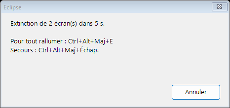
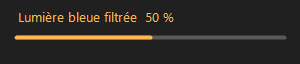
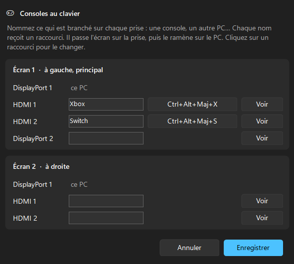
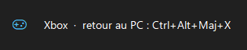

<p align="center">
  
</p>

<h1 align="center">Eclipse</h1>

<p align="center">
  <b>Éteignez vos écrans sans mettre le PC en veille, réglez leur luminosité jusque sous leur minimum, filtrez la lumière bleue et passez un écran sur vos consoles d'un raccourci.</b><br>
  <i>Turn your monitors off without putting the PC to sleep, dim them even below their minimum, filter blue light, and switch a monitor to your consoles with one shortcut.</i>
</p>

<p align="center">
  <a href="../../releases/latest"><b>Télécharger / Download</b></a> ·
  <a href="#français">Français</a> ·
  <a href="#english">English</a>
</p>

<p align="center">
  
  &nbsp;&nbsp;
  
</p>

---

## Français

Eclipse est un petit programme pour Windows qui vit près de l'heure, dans la barre des tâches. Il fait trois choses.

**1. Éteindre les écrans, le PC restant allumé.** D'un raccourci, les écrans s'éteignent, le clavier et la souris sont
bloqués et le son est coupé. Pendant ce temps, le PC continue de travailler : un téléchargement, un rendu, un calcul,
de la musique sur une autre sortie… Le même raccourci rallume tout.

**2. Régler la luminosité des écrans,** directement depuis Windows, sans passer par les boutons de l'écran. Et quand
le minimum de l'écran est encore trop lumineux, la nuit, Eclipse descend **en dessous**. Il filtre aussi la
**lumière bleue**, tout le temps ou seulement sous le minimum.

**3. Passer un écran sur une console,** d'un raccourci, quand une console est branchée sur l'une de ses prises
(HDMI…). Le même raccourci le ramène sur le PC.

Un seul fichier, environ 180 Ko, sans installation. Il ne s'appuie que sur ce qui est déjà dans Windows.

### Aperçu

| | |
|---|---|
|  | **Le menu de l'icône** (clic droit). Un double-clic sur l'icône éteint, un simple clic ouvre le panneau. |
|  | **5 secondes avant l'extinction**, le temps d'annuler (Échap ou le même raccourci). |
|  | **Pendant l'extinction.** Si vous touchez la souris ou une touche, l'écran se réveille 5 secondes pour vous rappeler comment rallumer, puis se rééteint. |
| <br><br> | **Le rappel** en bas de l'écran, quand vous réglez la luminosité ou la lumière bleue au clavier. Il ne prend pas le clavier. |
|  | **Le questionnaire des consoles** (menu de l'icône, *Consoles*). Eclipse lit les prises de chaque écran, et celle qui montre le PC. Vous nommez ce qui est branché sur les autres ; chaque nom reçoit son raccourci, qu'un clic change. *Voir* passe l'écran sur la prise 8 secondes, pour vérifier. |
|  | **Le message**, sur l'écran resté sur le PC, quand un écran passe sur une console. Il rappelle comment revenir. |

### Raccourcis

| Raccourci | Effet |
|---|---|
| **Ctrl + Alt + Maj + E** | Éteint les écrans, puis les rallume. Il se change depuis le menu. |
| **Ctrl + Alt + Maj + Échap** | Sortie de secours : tout revient, tout de suite. |
| **Ctrl + Alt + Maj + ↑ / ↓** | Luminosité +10 % / −10 % sur tous les écrans. Arrivé au minimum, ↓ continue en dessous. |
| **Ctrl + Alt + Maj + B** | Filtre la lumière bleue tout le temps. Le même raccourci revient à votre choix habituel. |
| **Ctrl + Alt + Maj + une lettre** | Passe un écran sur une console, puis le ramène sur le PC. Chaque console a sa lettre, donnée par le questionnaire, où un clic en choisit une autre combinaison. |
| **Clic** sur l'icône | Le panneau : luminosité, lumière bleue et consoles |
| **Double-clic** sur l'icône | Éteint les écrans |

Dans le panneau, on peut aussi utiliser la molette (±5 %), les flèches (±1 %) et Page haut / bas (±10 %).

### Ce qu'il fait, en détail

**L'extinction**
- **Les écrans s'éteignent vraiment** : ce n'est pas un simple fond noir. Le PC, lui, ne se met pas en veille.
- **Le clavier et la souris sont bloqués**, pour qu'un chat ou un enfant ne fasse rien à votre place. Seuls le raccourci et la sortie de secours rallument.
- **Le son est coupé**, par un simple « muet » des sorties de Windows. Aucun volume n'est changé, et le muet est retiré au retour, même après un arrêt brutal.
- **SteelSeries Sonar** : si vous l'utilisez, ses sorties sont notées avant l'extinction et remises au rallumage. Sans cela, Sonar bascule parfois sur le mauvais écran quand ils se rallument.
- **« Éteindre et verrouiller Windows »** fait la même chose, puis verrouille la session.
- **Au bout de 12 heures**, le clavier, la souris et le son reviennent seuls.

**La luminosité**
- **Un curseur par écran**, avec le nom de l'écran tel qu'il se présente à Windows et sa position (à gauche, à droite…).
- **« Lier les écrans »** pour les régler ensemble.
- **Sous le minimum** : à gauche du trait « min », le curseur passe en orange et descend jusqu'à −90 %. L'écran reste à son minimum réel, et c'est l'image qui est assombrie par l'effet de couleur de Windows. Pas de fenêtre posée par-dessus : rien ne cache, rien ne bloque les clics. L'effet disparaît de lui-même si Eclipse s'arrête.

**La lumière bleue**
- **Trois choix** dans le panneau : *Non* ; *Sous le min*, où le filtre vient avec l'assombrissement et atteint sa pleine chaleur à −30 % ; *Toujours*.
- **La chaleur** se règle au curseur, de 0 à 100 %. Pendant le réglage, le filtre se montre, même en *Sous le min*.
- **Ctrl + Alt + Maj + B** passe à *Toujours*, puis revient à votre choix habituel.
- Le filtre passe par le même effet de couleur de Windows que l'assombrissement : rien n'est posé par-dessus, et il disparaît si Eclipse s'arrête.
- **L'éclairage nocturne de Windows** ne se commande pas depuis un programme. S'il est allumé, les deux filtres s'additionnent.

**Les consoles**
- **Le questionnaire** (menu de l'icône, *Consoles*, puis *Régler les consoles...*) lit les prises que chaque écran annonce, et celle qui montre le PC. Vous nommez ce qui est branché sur les autres : une console, un autre PC… Chaque nom reçoit un raccourci : Ctrl + Alt + Maj et la première lettre du nom, ou un chiffre si elle est déjà prise.
- **Changer un raccourci** : un clic dessus, dans le questionnaire, puis la combinaison de votre choix (au moins deux touches parmi Ctrl, Alt et Maj, plus une autre touche). Il reste, même si vous renommez la console. Eclipse refuse une combinaison qui sert déjà (la lumière bleue, une autre console…) ou qui empêcherait d'écrire avec AltGr, comme Ctrl + Alt + E, qui écrit « € ».
- **Le raccourci** passe l'écran sur la console, et le même raccourci le ramène sur le PC. Le menu de l'icône et la carte *Consoles* du panneau font de même.
- **L'écran principal** : si l'écran de la console était l'écran principal de Windows, son voisin le devient le temps du jeu. La barre des tâches passe ainsi sur l'écran que vous voyez. Tout revient au retour sur le PC.
- **Si l'écran revient sur le PC sans Eclipse** (par son bouton, ou seul quand la console s'éteint), Eclipse le voit en quelques secondes et remet tout en place.
- **Quand Eclipse se ferme**, l'écran revient sur le PC. Après un arrêt brutal, Eclipse reprend où il en était au démarrage suivant.

### Installer

1. Téléchargez **Eclipse.exe** depuis la [dernière version](../../releases/latest).
2. Lancez-le. Son icône apparaît près de l'heure (au besoin, derrière la flèche **^**).
3. Clic droit sur l'icône, puis **« Lancer au démarrage de Windows »** si vous le voulez à chaque démarrage.

> **« Windows a protégé votre ordinateur »** : Eclipse n'est pas signé (un certificat coûte cher). Cliquez sur
> *Informations complémentaires*, puis *Exécuter quand même*. Vous pouvez aussi le compiler vous-même, voir ci-dessous.

**Pour régler la luminosité et passer sur les consoles**, l'option **DDC/CI** doit être activée dans le menu de vos
écrans. Elle l'est le plus souvent par défaut. Un écran qui ne répond pas est signalé dans le panneau et dans le
questionnaire des consoles.

**Désinstaller** : clic droit sur l'icône, *Quitter*, puis supprimez le fichier. Eclipse ne laisse que son journal,
dans `%LOCALAPPDATA%\Eclipse`, et ses réglages, dans `HKCU\Software\Eclipse`.

### Compiler soi-même

Pas de Visual Studio, pas de .NET à installer : le compilateur du .NET Framework 4 est déjà dans Windows.

```bat
git clone https://github.com/Hosni-Ismail/Eclipse.git
cd Eclipse
Compiler.bat
```

Tout le programme tient dans [`Eclipse.cs`](Eclipse.cs). Les commentaires expliquent chaque choix.

### Vie privée et sécurité

- **Rien n'est envoyé sur Internet.** Le seul échange réseau est local, avec SteelSeries Sonar, s'il est installé.
- **Eclipse n'écrit qu'à trois endroits** :
  - son journal, dans `%LOCALAPPDATA%\Eclipse`, qui note les extinctions, les rallumages, les passages sur les consoles et les erreurs ;
  - ses réglages, dans `HKCU\Software\Eclipse` : le raccourci, « Lier les écrans », la lumière bleue et les consoles ;
  - le lancement au démarrage, seulement si vous le cochez.
- **Pendant le jeu sur une console**, Eclipse peut aussi changer l'écran principal de Windows. Il le remet au retour sur le PC, ou au démarrage suivant si Eclipse ou Windows s'arrête pendant le jeu.
- **Le blocage du clavier et de la souris** utilise des « crochets » de Windows. Certains antivirus s'en méfient par principe. Le code est là pour être lu.
- **Si quelque chose coince**, il y a toujours une issue :
  - Ctrl + Alt + Maj + Échap ;
  - Ctrl + Alt + Suppr, puis Annuler ;
  - en dernier recours, le bouton d'alimentation.

### Limites

- **Windows 10 ou 11 uniquement.**
- **L'assombrissement sous le minimum** ne baisse pas le rétroéclairage : l'écran ne consomme pas moins, mais l'image paraît plus sombre.
- **L'assombrissement et le filtre de lumière bleue** valent pour tous les écrans à la fois.
- **Ce qui leur échappe** :
  - les jeux en plein écran « exclusif » ;
  - la loupe et les filtres de couleur de Windows, qui utilisent le même effet ;
  - l'image d'une console, qui ne passe pas par le PC.
- **La luminosité DDC/CI** ne concerne que les écrans externes. Celle de l'écran intégré d'un ordinateur portable n'est pas gérée.
- **Les consoles** : l'écran doit annoncer ses prises par DDC/CI et accepter de changer de prise sur ordre du PC. Beaucoup le font, pas tous : le questionnaire le dit. Il s'ouvre quand les écrans montrent le PC.
- **Le son d'une console** passe par l'écran, ses haut-parleurs ou sa prise casque : Eclipse n'y touche pas.
- **Les textes du programme sont en français.**

### Licence

[MIT](LICENSE) : utilisez-le, modifiez-le, partagez-le librement.

---

## English

Eclipse is a tiny Windows tray app that does three things.

**1. Turn your monitors off while the PC keeps running.** One shortcut turns the screens off, blocks the keyboard and
mouse, and mutes the sound, while downloads, renders or computations keep going. The same shortcut brings everything
back.

**2. Control your monitors' brightness** from Windows, without fiddling with the monitor's buttons. When the monitor's
lowest setting is still too bright at night, Eclipse goes **below it**. It also filters **blue light**, all the time
or only below the minimum.

**3. Switch a monitor to a console** with one shortcut, when a console is plugged into one of its inputs (HDMI…). The
same shortcut brings it back to the PC.

One single file, about 180 KB, nothing to install. It only relies on what Windows already ships with.

### Shortcuts

| Shortcut | What it does |
|---|---|
| **Ctrl + Alt + Shift + E** | Turns the monitors off, then back on. It can be changed from the menu. |
| **Ctrl + Alt + Shift + Esc** | Emergency exit: everything comes back, right away. |
| **Ctrl + Alt + Shift + ↑ / ↓** | Brightness +10% / −10% on all monitors. At the minimum, ↓ keeps going below it. |
| **Ctrl + Alt + Shift + B** | Filters blue light all the time. The same shortcut goes back to your usual choice. |
| **Ctrl + Alt + Shift + a letter** | Switches a monitor to a console, then back to the PC. Each console gets its letter from the questionnaire, where a click picks another combination. |
| **Click** the tray icon | The panel: brightness, blue light and consoles |
| **Double-click** the tray icon | Turns the monitors off |

### Features

**Turning the monitors off**
- **The monitors really turn off.** It's not just a black window, and the PC doesn't go to sleep.
- **The keyboard and mouse are blocked**, so a cat or a child can't do anything in your place. Touching them only wakes the screen for 5 seconds, to show how to get back.
- **The sound is muted** with a plain Windows "mute". No volume is ever changed, and the mute is removed when you come back, even after a crash.
- **SteelSeries Sonar**: if you use it, its outputs are saved before the monitors go off and restored afterwards. Otherwise Sonar can switch to the wrong monitor when they come back.
- **"Turn off and lock Windows"** does the same, then locks the session.
- **After 12 hours**, the keyboard, the mouse and the sound come back on their own.

**Brightness**
- **One slider per monitor**, showing the monitor's own name and its position (left, right…).
- **"Lier les écrans"** ("link monitors") adjusts them together.
- **Below the minimum**: left of the "min" mark, the slider turns orange and goes down to −90%. The monitor stays at its real minimum, and the picture itself is darkened through Windows' full-screen color effect. No window is drawn on top, so nothing is hidden and clicks still go through. The effect goes away by itself if Eclipse stops.

**Blue light**
- **Three choices** in the panel: *Non* (off); *Sous le min* (below the minimum), where the filter comes with the dimming and reaches full warmth at −30%; *Toujours* (always).
- **Warmth** goes from 0 to 100% with a slider. While you adjust it, the filter shows, even in *Sous le min*.
- **Ctrl + Alt + Shift + B** switches to *Toujours*, then back to your usual choice.
- The filter uses the same Windows color effect as the dimming: nothing is drawn on top, and it goes away if Eclipse stops.
- **Windows Night light** can't be controlled by apps. If it is on, both filters add up.

**Consoles**
- **The questionnaire** (tray menu, *Consoles*, then *Régler les consoles...*) reads the inputs each monitor announces, and the one showing the PC. You name what is plugged into the others: a console, another PC… Each name gets a shortcut: Ctrl + Alt + Shift and the name's first letter, or a digit if it is taken. *Voir* ("show") switches the monitor to that input for 8 seconds, to check.
- **Changing a shortcut**: click it in the questionnaire, then press the combination you want (at least two of Ctrl, Alt and Shift, plus another key). It stays even if you rename the console. Eclipse refuses a combination already in use (blue light, another console…) or one that would stop AltGr from typing, such as Ctrl + Alt + E, which types "€".
- **The shortcut** switches the monitor to the console, and the same shortcut brings it back to the PC. The tray menu and the panel's *Consoles* card do the same.
- **Main display**: if the console's monitor was Windows' main display, its neighbour becomes the main display while you play, so the taskbar moves to the monitor you're looking at. Everything comes back when you return to the PC.
- **If the monitor goes back to the PC without Eclipse** (with its own button, or by itself when the console turns off), Eclipse notices within seconds and puts everything back.
- **When Eclipse closes**, the monitor goes back to the PC. After a crash, Eclipse picks up where it left off at the next start.

### Install

1. Download **Eclipse.exe** from the [latest release](../../releases/latest).
2. Run it. Its icon shows up next to the clock (maybe behind the **^** arrow).
3. Right-click it, then **"Lancer au démarrage de Windows"** to start it with Windows.

> **"Windows protected your PC"**: Eclipse isn't code-signed. Click *More info*, then *Run anyway*, or build it
> yourself.

**For brightness control and consoles**, **DDC/CI** must be enabled in your monitors' menu. It usually is by default.

**Build it yourself**: no Visual Studio and no SDK needed, since the .NET Framework 4 compiler ships with Windows.
Clone the repository and run `Compiler.bat`. The whole program is [`Eclipse.cs`](Eclipse.cs). Its comments are in
French.

### Privacy and safety

- **Nothing is sent over the Internet.** The only network traffic is local, with SteelSeries Sonar if it is installed.
- **Eclipse only writes to three places**:
  - its log, in `%LOCALAPPDATA%\Eclipse`;
  - its settings, in `HKCU\Software\Eclipse` (shortcut, linked monitors, blue light, consoles);
  - the Windows startup entry, only if you tick it.
- **While you play on a console**, Eclipse may also change Windows' main display. It puts it back when you return to the PC, or at the next start if Eclipse or Windows stops while you play.
- **Blocking the keyboard and mouse** uses Windows input hooks, which some antivirus programs flag on principle. The code is here to be read.
- **There is always a way out**:
  - Ctrl + Alt + Shift + Esc;
  - Ctrl + Alt + Del, then Cancel;
  - as a last resort, the power button.

### Limitations

- **Windows 10 and 11 only.**
- **The user interface is in French.**
- **Dimming below the minimum** doesn't lower the backlight, so it saves no power.
- **The dimming and the blue light filter** apply to all monitors at once.
- **What they don't reach**:
  - exclusive full-screen games;
  - the Windows Magnifier and color filters, which use the same effect;
  - a console's picture, which doesn't go through the PC.
- **DDC/CI brightness** works on external monitors only. A laptop's built-in screen isn't covered.
- **Consoles**: the monitor must announce its inputs over DDC/CI and accept input changes from the PC. Many do, not all: the questionnaire tells you. It opens while the monitors show the PC.
- **A console's sound** goes through the monitor (its speakers or headphone jack): Eclipse doesn't touch it.

### License

[MIT](LICENSE).
